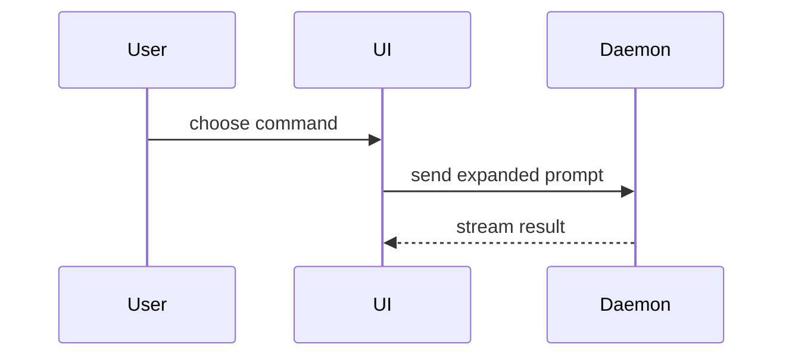

> 繁體中文翻譯。原文：[SKILL.md](../../../../skills/engineering/pr/SKILL.md)
>
> **description 中譯：** 撰寫 PR（pull request）內文時使用。

使用這個範本來撰寫 PR 內文：

```markdown
## Summary

<圖、diff 草圖或樹狀圖>

## Evidence

- **Before:** <截圖/輸出/失敗的測試執行結果>
  **After:** <截圖/輸出/通過的測試執行結果>

## Merge Danger

**Door:** <one-way 或 two-way>

<選填：說明>

**Blast Radius:** <用一個詞描述>

<選填：merge 之後可能造成的影響>
```

## 各段落 (Sections)

跳過所有開場白，文字保持簡短。使用 `GLOSSARY.md` 裡使用者的領域語言。

### 摘要 (Summary)

挑選能把重點講清楚的最小視角。

- 用 pseudocode（虛擬碼）呈現邏輯或演算法：

```text
on(save)
  if content is unchanged
    return cached result
  write new content
  return fresh result
```

- 用呼叫樹呈現執行期的控制流程：

```text
submitForm
  createSession
    persistPrompt
    launchAgent
  navigateToSession
```

- 用元件樹呈現 UI 結構，包括重要的狀態和 module（模組）邊界：

```text
<SessionPage> (apps/example/src/routes/session.tsx)
  useSessionEvents()
  <SessionToolbar>
    <RunSkillButton> (packages/ui)
```

- 用淺層的檔案樹呈現檔案職責或大範圍的 refactor（重構）：

```text
src/
├── commands/       # parses user actions
├── sessions/       # owns session state
└── transport/      # sends API requests
```

- 用 Mermaid 呈現元件互動、控制流程或資料流：



- 當重點是改了什麼、而周圍的形狀已經存在時，用 `diff`。讓 diff（差異）的形狀配合主題。

元件的改動：

```diff
 <SessionPage>
   useSessionEvents()
   <SessionToolbar>
+    <RunSkillButton />
   <SessionTimeline>
+    <SkillResultCard />
```

檔案結構的改動：

```diff
 src/
 ├── commands/
+│   └── show-me.ts       # expands the slash command
 ├── sessions/
-└── transport.ts
+└── transport/
+    ├── client.ts
+    └── stream.ts
```

呼叫樹或呼叫堆疊的改動：

```diff
 submitForm
   createSession
     persistPrompt
+    expandSkillMention
     launchAgent
-  navigateToSession
+  navigateToSession
+    subscribeToEvents
```

狀態或控制流程的改動：

```diff
 on(save)
-  write content
+  if content is unchanged
+    return cached result
+  write new content
+  invalidate cache
```

- 當大部分內容都是新的、當省略掉的 context（上下文）會隱藏所有權或順序，或當使用者需要一個可以複製的目標形狀時，就顯示整個區塊：

```ts
function expandSkill(command: string): string {
  const skillName = command.slice(1);
  return `use the ${skillName} skill`;
}
```

#### 指引 (Guidance)

把每個視覺化放在它所支援的那段簡短文字旁邊。只保留回答使用者當前問題、或解決當前討論點的選項所需要的呼叫、檔案、props、狀態和邊界。

你可以用其中一種，也可以用好幾種，你不太可能全部都用上。運用你的判斷，不要讓使用者被淹沒。

### 證據 (Evidence)

證明改動有效的具體證據。展示前後對照。

截圖是 S 級：當環境已經為它準備好，而且改動是視覺上的時候。

以執行為基礎的證據是 A 級。測試結果、console 輸出。用 pseudocode 展示現在會失敗、然後會通過的那個確切測試。

### 合併風險 (Merge Danger)

說明它是單向門 (one-way door) 還是雙向門 (two-way door)。你可以從雙向門走回來，但單向門不行。回滾成本低的 PR 風險比較低。涉及破壞性操作或難以反悔的決定的改動，就是單向門。

blast radius（爆炸半徑）是這個 PR 引入的改動可能造成的影響或範圍。考慮所有的可能性。例子有版面位移、對 consumer（使用端）造成的破壞、行動裝置的響應式排版等等。
